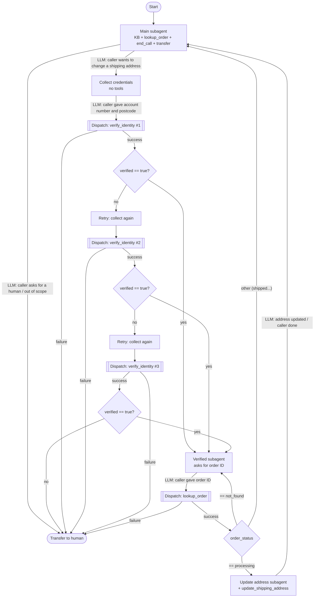

# NovaMart Agent: Tools and Workflow Setup

Backend base URL: `https://certification-elevenlabs.vercel.app/api`

All three webhook tools: **Method** `POST`, **Content type** JSON, no auth headers.

---

## 1. Dynamic variables (create first)

These hold tool results so the workflow can branch on them deterministically and so the privileged tool never receives an account number from the LLM.

| Variable | Set by | Default |
|---|---|---|
| `verified` | `verify_identity` assignment ← `success` | `false` |
| `verified_account_number` | `verify_identity` assignment ← `account_number` | empty |
| `customer_name` | `verify_identity` assignment ← `customer_name` | empty |
| `order_status` | `lookup_order` assignment ← `status` | empty |
| `current_order_id` | `lookup_order` assignment ← `order_id` | empty |

Give each one a default value (in the agent's dynamic variable placeholders, or when starting the conversation) so the agent never references an undefined variable.

On a failed verification the backend returns only `{"success": false}`. The `account_number` and `customer_name` paths don't exist, so those variables are **not** updated and stay empty.

---

## 2. Webhook tools

### `lookup_order`
- **URL:** `https://certification-elevenlabs.vercel.app/api/lookup_order`
- **Description:**
  > Looks up a NovaMart order by its order ID and returns its status, items, expected delivery date, and shipping address. Call it only after the caller has given an order ID and you have repeated it back to confirm it. If the result has status "not_found", tell the caller the order could not be found and ask them to check the ID. Never read the full shipping address aloud; refer to it by street name only.
- **Body parameters:**

| Name | Type | Value type | Description |
|---|---|---|---|
| `order_id` | string | LLM Prompt | The order ID the caller said, digits only with no spaces or dashes, for example 12345. |

- **Assignments (response → dynamic variable):** `status` → `order_status`, `order_id` → `current_order_id`

### `verify_identity`
- **URL:** `https://certification-elevenlabs.vercel.app/api/verify_identity`
- **Description:**
  > Verifies the caller's identity with their NovaMart account number and the postcode on the account. Returns success true with the customer's name, or success false. Required before changing a shipping address or sharing any account-specific information.
- **Body parameters:**

| Name | Type | Value type | Description |
|---|---|---|---|
| `account_number` | string | LLM Prompt | The caller's 8-digit NovaMart account number, digits only, for example 10000001. |
| `postcode` | string | LLM Prompt | The postcode on the caller's account, digits only, for example 94107. |

- **Assignments:** `success` → `verified`, `account_number` → `verified_account_number`, `customer_name` → `customer_name`

### `update_shipping_address` (privileged)
- **URL:** `https://certification-elevenlabs.vercel.app/api/update_shipping_address`
- **Description:**
  > Changes the shipping address of an order that is still processing. Call it only after the caller has confirmed the complete new address. After success, confirm the change to the caller by street name only.
- **Body parameters:**

| Name | Type | Value type | Description / value |
|---|---|---|---|
| `account_number` | string | **Dynamic variable** | `verified_account_number` (the LLM cannot supply it) |
| `order_id` | string | **Dynamic variable** | `current_order_id` (the order that was looked up and confirmed as processing) |
| `new_address` | string | LLM Prompt | The complete new shipping address the caller confirmed: street and number, city, state, and ZIP code. |

**Do not add this tool to the base agent's tool list.** Attach it only to the "Update address" subagent node.

### System tools
- `end_call`: enable on the base agent (global).
- `transfer_to_number`: enable on the base agent, or use a **Transfer to number** node in the workflow, with the human support number.

---

## 3. Workflow



**Why it is built this way:**
- **Structural gate:** `update_shipping_address` exists only in the "Update address" node, which can be reached only through `verified == true` *and* `order_status == processing`. No prompt can skip it.
- **Deterministic routing:** branching on verification and lookup results uses **expression** edges on dynamic variables set from the tool response, not LLM conditions.
- **3 attempts, then lockout:** the three attempts are unrolled as separate nodes, so the limit cannot be miscounted. After the third failure the call goes to a human.
- **LLM conditions only for conversation intent** (for example "the caller wants to change their address"), never for tool results.

---

## 4. Things to confirm in the dashboard

1. **What triggers the dispatch node's failure edge.** If it fires only on HTTP errors, a `200` with `success: false` takes the **success** edge. That is why the `verified == true?` expression check comes after it. If your test shows that `success: false` already takes the failure edge, you can route failure straight to the retry node.
2. **Expression syntax** for edges (for example `verified == true` or `order_status == "processing"`). Copy it from one of the five reference agents.
3. **The "Include global tools" toggle** on each subagent. Make sure `update_shipping_address` doesn't reach any node other than "Update address".

---

## 5. Quick test calls (PowerShell)

```powershell
$u = "https://certification-elevenlabs.vercel.app/api"
Invoke-RestMethod -Method Post -Uri "$u/lookup_order" -ContentType "application/json" -Body '{"order_id":"12345"}'
Invoke-RestMethod -Method Post -Uri "$u/verify_identity" -ContentType "application/json" -Body '{"account_number":"10000001","postcode":"94107"}'
Invoke-RestMethod -Method Post -Uri "$u/update_shipping_address" -ContentType "application/json" -Body '{"account_number":"10000001","order_id":"67890","new_address":"1 Main St, Springfield, IL 62701"}'
```
